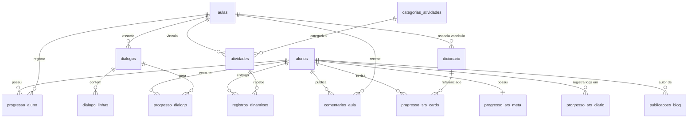

# 🗄️ 3. Banco de Dados Supabase (Modelagem de Dados)

O banco de dados PostgreSQL do Supabase opera como fonte única de verdade estruturada do portal.

### Diagrama de Relacionamento de Entidades (ERD)



---

### 📋 Detalhamento das 16 Tabelas Públicas

#### 1. Tabela: `alunos`
*Perfil do estudante, sincronizado com o Supabase Auth (`auth.users`).*
*   **`id`** (`uuid`, PK): Referência direta a `auth.users.id`.
*   **`nome`** (`text`): Nome completo do aluno.
*   **`status_matricula`** (`status_matricula_enum`, Nullable): Situação cadastral (`Ativa`, `Inativa`).
*   **`is_admin`** (`boolean`, Default `false`): Flag de privilégios de acesso ao Painel Administrativo (`/admin`).
*   **`created_at`** (`timestamp with time zone`): Data de cadastro.
*   **`updated_at`** (`timestamp with time zone`): Última atualização do perfil.

> [!IMPORTANT]
> **E-mail do Aluno:** O campo `email` **NÃO** existe na tabela `public.alunos`. Ele reside exclusivamente em `auth.users.email`. Para obter o e-mail em Server Actions ou Painel Admin, utilize o client admin (`lib/supabase/admin.ts`) via `supabaseAdmin.auth.admin.getUserById(id)` ou a listagem `supabaseAdmin.auth.admin.listUsers()`.

---

#### 2. Tabela: `aulas`
*Repositório de aulas e metadados de vídeo-aulas.*
*   **`id`** (`uuid`, PK): Identificador único da aula.
*   **`codigo_aula`** (`text`, Unique): Código sequencial amigável (Ex: `A01`, `001`).
*   **`codigo_licao`** (`text`, Nullable): Código pedagógico da lição no livro didático.
*   **`titulo_descritivo`** (`text`): Título completo da aula.
*   **`data_aula`** (`date`, Nullable): Data de realização ou liberação da aula.
*   **`videos`** (`jsonb`): Lista de links no formato `Array<{titulo?: string, url: string}>`.
*   **`link_material`** (`text`, Nullable): Link para material didático/slides.
*   **`link_tarefa`** (`text`, Nullable): Link externo para caderno de exercícios.
*   **`links_adicionais`** (`jsonb`): Links extras configuráveis (`Array<{titulo?: string, url: string}>`).
*   **`comentarios`** (`text`, Nullable): Notas internas do professor.
*   **`is_excecao`** (`boolean`, Default `false`): Flag de fluxo pedagógico simplificado.
*   **`created_at`** (`timestamp with time zone`): Criação da aula.

---

#### 3. Tabela: `progresso_aluno`
*Controle de completude e evolução do estudante.*
*   **`id`** (`uuid`, PK): Identificador único do registro de progresso.
*   **`aluno_id`** (`uuid`, FK -> `alunos.id`): Aluno proprietário.
*   **`aula_id`** (`uuid`, FK -> `aulas.id`): Aula rastreada.
*   **`aula_assistida`** (`boolean`, Default `false`): Vídeos assistidos.
*   **`tarefa_exercicios_concluida`** (`boolean`, Default `false`): Tarefa de fixação concluída.
*   **`tarefa_hanzi_concluida`** (`boolean`, Default `false`): Caligrafia de Hanzi concluída.
*   **`tarefa_excecao_concluida`** (`boolean`, Default `false`): Conclusão específica para aulas de exceção.
*   **`status`** (`status_progresso`, Enum): `Pendente`, `Em Andamento`, `Concluída`.
*   **`created_at`** (`timestamp with time zone`): Registro inicial.
*   **`updated_at`** (`timestamp with time zone`): Última atualização do progresso.

---

#### 4. Tabela: `dialogos`
*Cenários para o Simulador de Conversação Interativo.*
*   **`id`** (`uuid`, PK): Identificador do diálogo.
*   **`aula_id`** (`uuid`, FK -> `aulas.id`): Aula associada.
*   **`titulo`** (`text`): Título do cenário (Ex: "Comprando Frutas").
*   **`cenario`** (`text`): Contextualização pré-conversa.
*   **`ordem_exibicao`** (`integer`): Peso numérico de ordenação na lista.
*   **`created_at`** (`timestamp with time zone`): Criação do diálogo.

---

#### 5. Tabela: `dialogo_linhas`
*Falas sequenciais do simulador conversacional.*
*   **`id`** (`uuid`, PK): Identificador da fala.
*   **`dialogo_id`** (`uuid`, FK -> `dialogos.id`): Diálogo pai.
*   **`ordem`** (`integer`): Posição ordinal na conversa (0, 1, 2...).
*   **`fala_pc_hanzi`** (`text`), **`fala_pc_pinyin`** (`text`), **`fala_pc_pt`** (`text`): Interlocutor chinês.
*   **`resposta_certa_hanzi`** (`text`), **`resposta_certa_pinyin`** (`text`), **`resposta_certa_pt`** (`text`): Resposta correta.
*   **`opcao2_hanzi`** (`text`), **`opcao2_pinyin`** (`text`), **`opcao2_pt`** (`text`), **`opcao2_correcao`** (`text`): Distrator 1 e feedback.
*   **`opcao3_hanzi`** (`text`), **`opcao3_pinyin`** (`text`), **`opcao3_pt`** (`text`), **`opcao3_correcao`** (`text`): Distrator 2 e feedback.
*   **`created_at`** (`timestamp with time zone`): Criação da linha.

---

#### 6. Tabela: `progresso_dialogo`
*Estatísticas do aluno no simulador.*
*   **`aluno_id`** (`uuid`, FK -> `alunos.id`): Aluno praticante.
*   **`dialogo_id`** (`uuid`, FK -> `dialogos.id`): Diálogo praticado.
*   *PK Composta:* (`aluno_id`, `dialogo_id`).
*   **`jogadas`** (`integer`, Default `0`): Sessões jogadas.
*   **`melhor_taxa_acerto`** (`integer`): Recorde de acerto na primeira tentativa (em %).
*   **`total_erros_historico`** (`integer`): Total acumulado de erros.
*   **`ultimo_acesso`** (`timestamp with time zone`): Última sessão de treino.
*   *Índice Cobrindo FK:* `idx_progresso_dialogo_dialogo_id` em `dialogo_id`.

---

#### 7. Tabela: `dicionario`
*Vocabulário e termos do portal e do motor SRS.*
*   **`id`** (`uuid`, PK): Identificador do termo.
*   **`aula_id`** (`uuid`, FK -> `aulas.id`): Aula introdutória no portal.
*   **`licao_oficial_id`** (`uuid`, FK -> `aulas.id`, Nullable): Lição oficial do livro didático.
*   **`tipo`** (`text`): Classificação (`Palavra`, `Frase`).
*   **`tipo_nota`** (`text`, Nullable): Modelo da nota de estudo.
*   **`deck`** (`text`, Nullable): Agrupamento de deck temático.
*   **`hanzi_simp`** (`text`): Caractere chinês Simplificado.
*   **`hanzi_trad`** (`text`, Nullable): Caractere chinês Tradicional.
*   **`pinyin`** (`text`): Pinyin fonético acentuado.
*   **`traducao`** (`text`): Tradução em português.
*   **`explicacao`** (`text`, Nullable): Notas gramaticais e estruturais.
*   **`curiosidade`** (`text`, Nullable): Contexto cultural.
*   **`exemplos`** (`text`, Nullable): Frases de aplicação no formato HTML ANKI.
*   **`som`** (`text`, Nullable): Nome do arquivo de áudio fonético no Supabase Storage.
*   **`created_at`** (`timestamp with time zone`): Data de inclusão.
*   *Índice Cobrindo FK:* `idx_dicionario_licao_oficial_id` em `licao_oficial_id`.

---

#### 8. Tabela: `categorias_atividades`
*Classificação de atividades pedagógicas.*
*   **`id`** (`uuid`, PK): Identificador da categoria.
*   **`nome`** (`text`): Nome da categoria (`Provas`, `Eventos (Utilidade)`).
*   **`descricao`** (`text`, Nullable): Descrição da finalidade.
*   **`created_at`** (`timestamp with time zone`): Data de criação.

---

#### 9. Tabela: `atividades`
*Provas, simulados e cadernos de exercícios dinâmicos.*
*   **`id`** (`uuid`, PK): Identificador da prova.
*   **`titulo`** (`text`): Nome da atividade.
*   **`descricao`** (`text`, Nullable): Descrição ou orientações ao aluno.
*   **`categoria_id`** (`uuid`, FK -> `categorias_atividades.id`): Categoria associada.
*   **`aula_id`** (`uuid`, FK -> `aulas.id`, Nullable): Aula de apoio associada.
*   **`estrutura`** (`jsonb`): Objeto do tipo `EstruturaAtividadeProva` contendo `configuracoes` e array `questoes`.
*   **`is_ativo`** (`boolean`, Default `false`): Disponibilidade para os estudantes.
*   **`created_at`** (`timestamp with time zone`): Data de criação.
*   **`updated_at`** (`timestamp with time zone`): Última edição.

---

#### 10. Tabela: `registros_dinamicos`
*Entregas e folhas de respostas dos alunos com notas e correções.*
*   **`id`** (`uuid`, PK): Identificador do registro de entrega.
*   **`atividade_id`** (`uuid`, FK -> `atividades.id`): Atividade submetida.
*   **`aluno_id`** (`uuid`, FK -> `alunos.id`): Aluno autor da entrega.
*   *Restrição Unique:* (`atividade_id`, `aluno_id`) garantindo uma entrega por aluno por atividade.
*   **`status`** (`status_registro_enum`): `Rascunho`, `Pendente`, `Corrigido`, `Concluido`.
*   **`dados`** (`jsonb`): Respostas, pontuações calculadas e feedbacks do professor (`DadosRegistroProva`).
*   **`created_at`** (`timestamp with time zone`): Data da primeira submissão.
*   **`updated_at`** (`timestamp with time zone`): Último salvamento.

---

#### 11. Tabela: `registros_dinamicos_lixeira`
*Lixeira de auditoria para exclusão segura de entregas.*
*   **`id`** (`uuid`, PK): Identificador do item na lixeira.
*   **`registro_id`** (`uuid`): ID do registro original que foi apagado.
*   **`atividade_id`** (`uuid`): Atividade associada.
*   **`aluno_id`** (`uuid`, Nullable): Aluno autor.
*   **`status`** (`text`, Nullable): Status no momento da exclusão.
*   **`dados`** (`jsonb`, Nullable): Snapshot completo das respostas no momento da exclusão.
*   **`motivo`** (`text`, Nullable): Justificativa do cancelamento ou reset.
*   **`apagado_por_id`** (`uuid`, Nullable): Usuário/Professor que executou a exclusão.
*   **`criado_em`** (`timestamp with time zone`): Criação original.
*   **`atualizado_em`** (`timestamp with time zone`): Última edição prévia.
*   **`apagado_em`** (`timestamp with time zone`, Default `now()`): Momento do descarte.

---

#### 12. Tabela: `comentarios_aula`
*Discussões pedagógicas, dúvidas e comentários vinculados a cada aula.*
*   **`id`** (`uuid`, PK): Identificador do comentário.
*   **`aula_id`** (`uuid`, FK -> `aulas.id`): Aula onde o comentário foi feito.
*   **`aluno_id`** (`uuid`, FK -> `alunos.id`): Autor da mensagem.
*   **`texto`** (`text`): Conteúdo textual do comentário.
*   **`created_at`** (`timestamp with time zone`): Timestamp da postagem.
*   *Índices Cobrindo FK:* `idx_comentarios_aula_aula_id` em `aula_id` e `idx_comentarios_aula_aluno_id` em `aluno_id`.

---

#### 13. Tabela: `publicacoes_blog`
*Artigos, matérias culturais e conteúdos publicados na Biblioteca do portal.*
*   **`id`** (`uuid`, PK): Identificador único do post.
*   **`slug`** (`text`, Unique): URL amigável do post.
*   **`titulo`** (`text`): Título do artigo.
*   **`categoria`** (`text`): Categoria temática.
*   **`conteudo`** (`jsonb`): Documento estruturado do editor Tiptap (blocos ricos, áudios e imagens).
*   **`capa_url`** (`text`, Nullable): URL da imagem de capa.
*   **`autor_id`** (`uuid`, FK -> `alunos.id`, Nullable): Autor do artigo.
*   **`status`** (`text`, Default `'rascunho'`): `rascunho`, `publicado`, `arquivado`.
*   **`data_publicacao`** (`timestamp with time zone`): Data oficial de publicação.
*   **`e_destaque`** (`boolean`, Default `false`): Artigo fixado em destaque na home da biblioteca.
*   **`tags`** (`text[]`, Default `{}`): Array de tags de categorização.
*   **`ordem_exibicao`** (`integer`, Default `0`): Prioridade de ordenação.
*   **`created_at`** (`timestamp with time zone`): Data de criação.
*   **`updated_at`** (`timestamp with time zone`): Última alteração de conteúdo.
*   *Índice Cobrindo FK:* `idx_publicacoes_blog_autor_id` em `autor_id`.

---

#### 14. Tabela: `progresso_srs_meta`
*Metadados de configuração e ofensiva (Streak) do motor SRS.*
*   **`aluno_id`** (`uuid`, PK, FK -> `alunos.id` ON DELETE CASCADE): Aluno proprietário.
*   **`srs_habilitado`** (`boolean`, Default `false`): Ativação voluntária do SRS.
*   **`streak_atual`** (`integer`, Default `0`): Dias consecutivos atuais de estudo.
*   **`streak_maxima`** (`integer`, Default `0`): Recorde histórico de ofensiva.
*   **`ultima_revisao`** (`timestamp with time zone`, Nullable): Data/hora da última sessão finalizada.
*   **`virada_hora`** (`integer`, Default `1`): Hora de rollover de virada do dia (ex: 1h da madrugada).
*   **`limite_novas`** (`integer`, Default `10`): Novos cartões por dia.
*   **`retencao_reduzida`** (`boolean`, Default `false`): Modo 80% retenção (menos carga).
*   **`filtro_padrao`** (`text`, Default `'Ambos'`): `Ambos`, `Palavras`, `Frases`.
*   **`updated_at`** (`timestamp with time zone`): Última atualização de configurações.

---

#### 15. Tabela: `progresso_srs_cards`
*Cartões individuais do motor FSRS (Free Spaced Repetition Scheduler).*
*   **`id`** (`uuid`, PK): Identificador do cartão SRS.
*   **`aluno_id`** (`uuid`, FK -> `alunos.id` ON DELETE CASCADE): Aluno proprietário.
*   **`dicionario_id`** (`uuid`, FK -> `dicionario.id` ON DELETE CASCADE): Termo estudado.
*   **`due`** (`timestamp with time zone`, Default `now()`): Prazo da próxima revisão.
*   **`stability`** (`double precision`): Estabilidade de memória calculada pelo FSRS.
*   **`difficulty`** (`double precision`): Dificuldade atual estimada (0 a 10).
*   **`elapsed_days`** (`integer`): Dias decorridos desde a revisão anterior.
*   **`scheduled_days`** (`integer`): Próximo intervalo de dias agendado.
*   **`reps`** (`integer`): Total de repetições efetuadas.
*   **`lapses`** (`integer`, Default `0`): Quantidade de esquecimentos ("Again").
*   **`learning_steps`** (`integer`, Default `0`): Etapa na fila de aprendizado.
*   **`state`** (`integer`): `0: New, 1: Learning, 2: Review, 3: Relearning`.
*   **`last_review`** (`timestamp with time zone`, Nullable): Timestamp da última repetição.
*   **`created_at`** (`timestamp with time zone`): Criação do cartão.
*   *Restrição Unique:* (`aluno_id`, `dicionario_id`).
*   *Índice Cobrindo FK:* `idx_progresso_srs_cards_dicionario_id` em `dicionario_id`.

---

#### 16. Tabela: `progresso_srs_diario`
*Logs de revisões e tempos de estudo diários (alimenta o Heatmap).*
*   **`aluno_id`** (`uuid`, FK -> `alunos.id` ON DELETE CASCADE): Aluno proprietário.
*   **`data`** (`date`): Data da revisão (fuso Brasília com rollover `virada_hora`).
*   *PK Composta:* (`aluno_id`, `data`).
*   **`quantidade`** (`integer`): Total de revisões concluídas no dia.
*   **`tempo_revelacao_segundos`** (`integer`): Segundos acumulados de recall (pensar na resposta).
*   **`tempo_estudo_segundos`** (`integer`): Segundos acumulados de estudo pós-revelação.
*   **`is_ajuste_adm`** (`boolean`, Default `false`): Marcador de inserção manual de ajuste pelo professor.

---

### 🛡️ Padrões de Segurança, RLS e Desempenho

#### 1. Prevenção de Auth RLS InitPlan
Em todas as políticas de Row-Level Security, referências a funções de autenticação do Supabase devem ser encapsuladas em subqueries:
```sql
-- CORRETO (subquery escalar cacheadas pelo planejador de consultas):
USING ((select auth.uid()) = aluno_id)
USING ((select auth.role()) = 'authenticated')

-- PROIBIDO (avaliação linha a linha, causa gargalo severo de CPU em scans):
USING (auth.uid() = aluno_id)
```

#### 2. Índices de Cobertura para Chaves Estrangeiras (Foreign Keys)
Para eliminar locks de tabela em cascata e acelerar joins:
- `idx_comentarios_aula_aluno_id` ON `comentarios_aula(aluno_id)`
- `idx_comentarios_aula_aula_id` ON `comentarios_aula(aula_id)`
- `idx_dicionario_licao_oficial_id` ON `dicionario(licao_oficial_id)`
- `idx_progresso_dialogo_dialogo_id` ON `progresso_dialogo(dialogo_id)`
- `idx_progresso_srs_cards_dicionario_id` ON `progresso_srs_cards(dicionario_id)`
- `idx_publicacoes_blog_autor_id` ON `publicacoes_blog(autor_id)`

#### 3. Proteção de Search Path em Funções do Banco
Todas as funções armazenadas (RPCs e triggers) devem conter caminho determinístico para evitar ataques de injeção por search path móvel:
```sql
ALTER FUNCTION public.update_modtime() SET search_path = public, extensions;
ALTER FUNCTION public.generate_blog_slug(text) SET search_path = public, extensions;
ALTER FUNCTION public.update_blog_updated_at() SET search_path = public, extensions;
ALTER FUNCTION public.handle_new_user() SET search_path = public, extensions;
```

#### 4. Contrato Tipado TypeScript (`types/database.types.ts`)
O arquivo `types/database.types.ts` é a fonte canônica tipada no frontend e backend Next.js. O validador determinístico do repositório garante a conformidade contínua:
```bash
python3 .agents/skills/portal-backend/scripts/schema_validator.py .
```
E as conexões com o banco devem usar os wrappers padronizados em `lib/supabase/`:
- `lib/supabase/client.ts` (Cliente singleton do navegador)
- `lib/supabase/server.ts` (Cliente do servidor com `await cookies()` compatível com Next.js 16)
- `lib/supabase/admin.ts` (Cliente de serviço para Server Actions administrativas)
