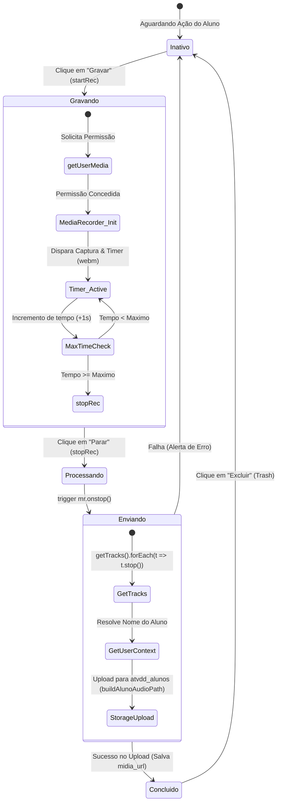
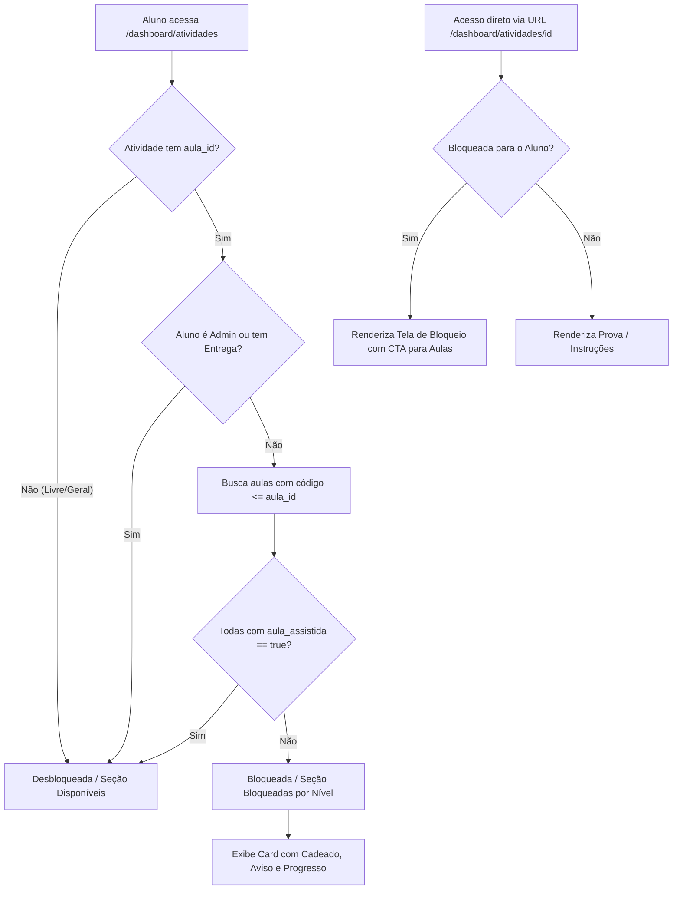

# ⚡ 5. O Motor de Provas Dinâmico & MediaRecorder

O motor de provas dinâmico processa estruturas complexas polimórficas de avaliações, cadernos de exercícios e redações.

### 5.1 Tipos Polimórficos de Questões (`types/atividades.ts`)
Cada prova salva na tabela `atividades` tem sua estrutura estritamente tipada. O vetor de questões suporta cinco categorias de tipos de dados:

```typescript
export type TipoQuestao = 
  | 'multipla_escolha' 
  | 'ordenacao' 
  | 'texto_livre' 
  | 'audio_upload'
  | 'preencher_lacunas';
```

Abaixo está o detalhamento estrutural de cada tipo em formato JSON estruturado:

*   **Múltipla Escolha (`multipla_escolha`):**
    ```json
    {
      "id": "q_mc_01",
      "tipo": "multipla_escolha",
      "enunciado": "Selecione o ideograma correspondente a 'Ni Hao':",
      "permite_multiplas_respostas": false,
      "opcoes": [
        { "id": "opt_a", "texto_simples": "你好" },
        { "id": "opt_b", "texto_simples": "再见" }
      ],
      "respostas_corretas_ids": ["opt_a"],
      "pontuacao_maxima": 2
    }
    ```
*   **Ordenação / Drag-and-Drop (`ordenacao`):**
    Renderizado pelo componente `OrderingQuestion.tsx` utilizando `@dnd-kit` (`@dnd-kit/core` e `@dnd-kit/sortable` com `DragOverlay`):
    - **Desktop (Mouse):** `MouseSensor` com ativação suave por distância mínima (4px), permitindo arraste instantâneo e livre sem conflito com cliques.
    - **Mobile (Touch):** `TouchSensor` com `delay: 220ms` e `tolerance: 6px`, permitindo rolagem vertical suave na página e ativando o arraste apenas quando o aluno segura o bloco.
    - **Performance & Estabilidade:** O estado de resposta só é despachado em `onDragEnd` ao soltar o item, eliminando render-loops intermediários.
    - **Acessibilidade:** Suporte a teclado via `KeyboardSensor` e botões dedicados de `ArrowUp` e `ArrowDown`.
    ```json
    {
      "id": "q_ord_02",
      "tipo": "ordenacao",
      "enunciado": "Ordene a frase gramaticalmente correta:",
      "itens_para_ordenar": [
        { "id": "it_1", "texto_simples": "wǒ" },
        { "id": "it_2", "texto_simples": "shì" },
        { "id": "it_3", "texto_simples": "xuésheng" }
      ],
      "ordem_correta_ids": ["it_1", "it_2", "it_3"],
      "pontuacao_maxima": 5
    }
    ```
*   **Texto Livre (`texto_livre`):**
    ```json
    {
      "id": "q_tl_03",
      "tipo": "texto_livre",
      "enunciado": "Escreva uma redação de 100 caracteres sobre sua família.",
      "limite_caracteres": 200,
      "pontuacao_maxima": 10
    }
    ```
*   **Upload de Áudio / Pronúncia (`audio_upload`):**
    ```json
    {
      "id": "q_au_04",
      "tipo": "audio_upload",
      "enunciado": "Leia o texto acima com a entonação correta dos tons.",
      "tempo_maximo_segundos": 60,
      "pontuacao_maxima": 8
    }
    ```
*   **Preenchimento de Lacunas (`preencher_lacunas`):**
    ```json
    {
      "id": "q_pl_05",
      "tipo": "preencher_lacunas",
      "texto_com_lacunas": "Nǐ hǎo! Wǒ [___] Zhōngguórén. Nǐ [___] ma?",
      "respostas_corretas_por_lacuna": {
        "lacuna_0": ["shì", "shi"],
        "lacuna_1": ["ne"]
      },
      "pontuacao_maxima": 4
    }
    ```

---

### 5.2 Ciclo de Vida do Microfone & Hardware (`AudioUploadQuestion.tsx`)

A captação ativa de voz para avaliação de pronúncia é processada via `MediaRecorder` nativo do navegador, operando sob um ciclo de vida rigoroso para evitar leaks de hardware e garantir a consistência dos envios:



1.  **Inicialização Resiliente do Stream:** Ao clicar em `Gravar`, a aplicação dispara `navigator.mediaDevices.getUserMedia({ audio: true })`.
2.  **Formato do Buffer de Áudio:** O `MediaRecorder` é configurado sob o mimeType `audio/webm` (compatível com a maioria dos navegadores modernos). Um listener de `ondataavailable` empilha os blocos binários de áudio (`Blob`) no vetor `chunksRef.current`.
3.  **Fechamento Seguro de Canais de Hardware:** No momento da interrupção (seja por clique do aluno em parar, finalização do temporizador limite ou desmonte abrupto do componente via `useEffect` cleanup), o sistema dispara `stream.getTracks().forEach(track => track.stop())`. Isso desliga ativamente o hardware de captação física do microfone do dispositivo, impedindo que o indicador de gravação do browser continue piscando em vermelho na aba e eliminando perdas de memória e hardware.
4.  **Resolução Dinâmica do Contexto do Aluno:** No método `uploadBlob()`, a rota de salvamento chama de forma assíncrona o cliente do Supabase:
    ```typescript
    const { data: { user } } = await supabase.auth.getUser();
    ```
    Isso busca o perfil na tabela `alunos` para obter o nome real do estudante no momento exato do upload do arquivo. Essa arquitetura resolve bugs de temporização que ocorrem quando se depende de props estáticas que podem estar nulas na inicialização do formulário.
5.  **Fallback Físico de Upload:** Caso o navegador do estudante não suporte a API do `MediaRecorder` ou a permissão do microfone seja bloqueada nas configurações de privacidade, o componente exibe um controle de **Fallback** com `input[type="file"]` permitindo que o aluno grave a resposta por um aplicativo externo de sua preferência no celular/computador e submeta o arquivo de áudio diretamente para o portal.

---

### 5.3 Lógica de Sincronização & Auto-Salvar Híbrido

As respostas das provas dinâmicas são protegidas contra instabilidades de conexão por um motor de sincronização híbrido baseado em **Debounce** e gravação de **Garantia de Dupla Camada** (LocalStorage + Supabase):

```plaintext
      [ Ação do Estudante na Prova (Digitar/Mudar Opção) ]
                              │
                              ▼
            ┌───────────────────────────────────┐
            │   Gravação Imediata Síncrona      │
            │   - LocalStorage (Draft Local)    │
            └─────────────────┬─────────────────┘
                              │
                              ▼
            ┌───────────────────────────────────┐
            │ Dispara Debounce Temporizado (2.5s)│
            └─────────────────┬─────────────────┘
                              │
              ┌───────────────┴───────────────┐
              ▼                               ▼
    [ Nova Ação antes de 2.5s? ]    [ Sem Ações por 2.5s ]
              │                               │
              ▼                               ▼
    ┌───────────────────┐           ┌───────────────────┐
    │ Cancela Timer     │           │ Dispara Mutation  │
    │ Reinicia Ciclo    │           │ (Salvar no Supabase)│
    └───────────────────┘           └─────────┬─────────┘
                                              │
                              ┌───────────────┴───────────────┐
                              ▼                               ▼
                     [ Conexão Online ]              [ Estado Offline ]
                              │                               │
                              ▼                               ▼
                    ┌───────────────────┐           ┌───────────────────┐
                    │ Grava no Banco    │           │ Mantém no Draft   │
                    │ Status: 200 OK    │           │ UI Exibe Badge    │
                    │ Badge: Sincronizado│          │ "Offline (local)" │
                    └───────────────────┘           └───────────────────┘
```

*   **Cancelamento Silencioso no Desmonte:** Se o estudante fechar a aba repentinamente, ou mudar de rota no painel, o hook de desmonte `useEffect` intercepta o ciclo de vida, cancela qualquer timeout de debounce pendente e força o envio instantâneo e assíncrono do rascunho de respostas atualizado via Server Action com a flag de controle `isSilencioso: true` para o banco de dados.

---

### 5.4 Formatação Avançada de Lacunas & Layouts Responsivos (`FillBlanksQuestion.tsx`)

A renderização e o preenchimento de lacunas utilizam o pacote `html-react-parser` para processar a string HTML estruturada:

1.  **Substituição Dinâmica por Regex:** O parser examina o conteúdo e identifica strings no formato `[___]`.
2.  **Injeção de Componentes Controlados:** O motor substitui o texto estático por elementos `<input type="text" />` estilizados, que atualizam o dicionário de respostas `mapa_lacunas` associado a chaves sequenciais (`lacuna_0`, `lacuna_1`, ...).
3.  **Layout Responsivo e Correção de UX Móvel:** Em dispositivos móveis de tela pequena, o teclado nativo do smartphone pode cobrir ou rolar a tela de forma irregular ao focar em inputs distribuídos no meio de fluxos de textos longos. Para resolver isso, o componente implementa uma **Pilha de Backup Mobile (`sm:hidden`)**: se o texto contiver mais de duas lacunas, um bloco estruturado em formato de lista linear é renderizado no rodapé do card. O estudante pode digitar suas respostas diretamente na lista linear unificada, e o estado é sincronizado de forma bidirecional com os inputs inline de cima.

---

### 5.5 Controle de Acesso por Nível de Aula (Pré-requisitos Pedagógicos)

As provas e atividades suportam vinculação direta com a trilha de aulas via coluna `atividades.aula_id`:



1. **Atividades Livres (`aula_id === null`):** Atividades gerais ou testes de nivelamento sem restrição de nível são exibidas sempre no topo/seção de Disponíveis.
2. **Atividades com Nível (`aula_id !== null`):** Requerem que o estudante tenha assistido **todas as aulas sequenciais até o código da aula vinculada** (`codigo_aula <= target_codigo_aula`).
3. **Seção de Bloqueadas & Ordenação:**
   - Atividades não desbloqueadas são agrupadas na seção dedicada "Atividades Bloqueadas por Nível", exibindo card com cadeado, mensagem explicativa, barra de progresso de aulas assistidas e atalho rápido para assistir às aulas pendentes.
   - Atividades bloqueadas e disponíveis são ordenadas crescentemente pelo nível da aula vinculada (`targetLessonNumber`).
4. **Proteção da Rota Dinâmica (`/dashboard/atividades/[id]`):**
   - Intercepta tentativas de acesso direto por URL, bloqueando a execução da prova para estudantes não autorizados e exibindo uma tela amigável de pré-requisitos pendentes.
   - Administradores (`is_admin: true`) e alunos com provas já submetidas mantêm acesso total para testes e revisão de notas.
5. **Reatividade em Tempo Real:** A marcação de aulas no Dashboard dispara a invalidação imediata do cache de atividades (`atividades-aluno` e `progresso-aluno-atividades`), desbloqueando instantaneamente as avaliações correspondentes quando o aluno transita de tela.

