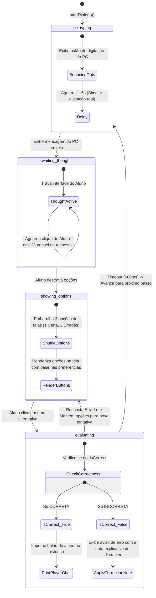

# 💬 6. O Simulador de Diálogos WhatsApp-Style (Meta-cognitivo)

O **Simulador de Diálogos** é uma ferramenta interativa e dinâmica que reproduz visualmente uma conversa real em formato de chat de mensagens instantâneas (semelhante ao WhatsApp). Ele roda inteiramente sobre uma máquina de estados de turno projetada para incentivar a memorização ativa e a reflexão gramatical.

### 6.1 Máquina de Estados Finita de Turnos (`TurnState`)

A dinâmica de conversação opera sob cinco estados rígidos de controle na UI:

---

### 6.2 O Mecanismo Meta-cognitivo "Já pensei na resposta"

Diferente de simuladores convencionais que exibem as opções de múltipla escolha imediatamente (o que incentiva o aluno a ler apenas as alternativas por dedução visual direta, ao invés de compreender o balão original do interlocutor nativo), o portal implementa um fluxo meta-cognitivo:
1.  **Exibição Bloqueada:** A mensagem em caracteres chineses (Hanzi) e Pinyin do interlocutor do computador é impressa no chat.
2.  **Ocultamento de Alternativas:** O rodapé de opções fica completamente invisível.
3.  **Processamento Mental:** É exibido um botão proeminente: `💡 Já pensei na resposta`.
4.  **Engajamento de Memorização:** O aluno é induzido a ler a mensagem recebida, traduzi-la mentalmente e formular sua resposta na mente antes de ser exposto a opções visuais facilitadoras. Apenas ao clicar no botão as alternativas de múltipla escolha são renderizadas em tela.

---

### 6.3 WhatsApp Ticks & Contexto Temporal Local (`getHoraMandarim`)

Para maximizar a imersão e o apelo visual, o simulador implementa detalhes estéticos de ponta:
*   **Balões com Double Checks:** As mensagens enviadas pelo estudante possuem um marcador animado de confirmação no estilo do WhatsApp (`MessageChecks`). Ao aparecer, exibe um check simples branco/cinza (`Check`), transmutando-se de forma suave com um atraso animado de `600ms` para um check duplo azul (`CheckCheck`), indicando visualmente que o interlocutor "leu" a mensagem.
*   **Conexão Temporal Cultural (`getHoraMandarim`):** Cada balão de mensagem exibe um marcador de data e hora. Em vez de exibir apenas a hora de forma comum (ex: `14:30`), a função detecta o horário atual e injeta a classificação correspondente de acordo com as regras culturais e linguísticas da China:
    *   `00h00 às 04h59` -> `凌晨` (Madrugada)
    *   `05h00 às 08h59` -> `早上` (Manhã cedo)
    *   `09h00 às 10h59` -> `上午` (Manhã)
    *   `11h00 às 12h59` -> `中午` (Meio-dia)
    *   `13h00 às 17h59` -> `下午` (Tarde)
    *   `18h00 às 23h59` -> `晚上` (Noite)
    *   *Exemplo de exibição:* `下午 03:15`. Se o estudante clicar no balão de áudio, um card extra explica a gramática e o significado do termo temporal (Ex: `下午 (xiàwǔ) = Tarde`).

---

### 6.4 Tratamento de Feedbacks Gramaticais e Recorde Pedagógico

O simulador rastreia a evolução qualitativa e armazena os dados com alta precisão na tabela `progresso_dialogo`:

1.  **Correção Explícita de Distractors:** Cada resposta incorreta (distractor) configurada pelo professor possui um campo de nota explicativa associado (`opcao2_correcao`, `opcao3_correcao`). Quando o aluno clica em uma alternativa errada, a UI não apenas sinaliza o erro, mas renderiza um alerta explicativo personalizado mostrando o porquê de aquela resposta ser inválida gramaticalmente naquela situação.
2.  **Cálculo Estrito de Acertos de Primeira:**
    *   O sistema conta os acertos em que o aluno escolheu a alternativa correta na **primeira tentativa** (`acertosPrimeira`).
    *   Se o aluno errar uma questão, a flag `errouAtual` transita para `true`. O aluno ainda pode tentar novamente para continuar a conversa, mas aquela questão não pontuará para a métrica de acertos de primeira.
    *   La taxa de acerto registrada na finalização é calculada estritamente como:
        $$\text{taxaAcerto} = \text{Math.round}\left(\frac{\text{acertosPrimeira}}{\text{totalLinhas}} \times 100\right)$$
3.  **Mutações Otimistas via React Query (`saveProgressMutation`):** Ao concluir o diálogo, a mutação dispara um `upsert` na tabela `progresso_dialogo`. Para eliminar atrasos na tela de encerramento, o método `onMutate` atualiza de forma otimista o cache local da query `['dialogos', userId]`, re-calculando o recorde e o total de jogadas imediatamente na tela de listagem de diálogos sem aguardar a conclusão da chamada de rede no Supabase.
