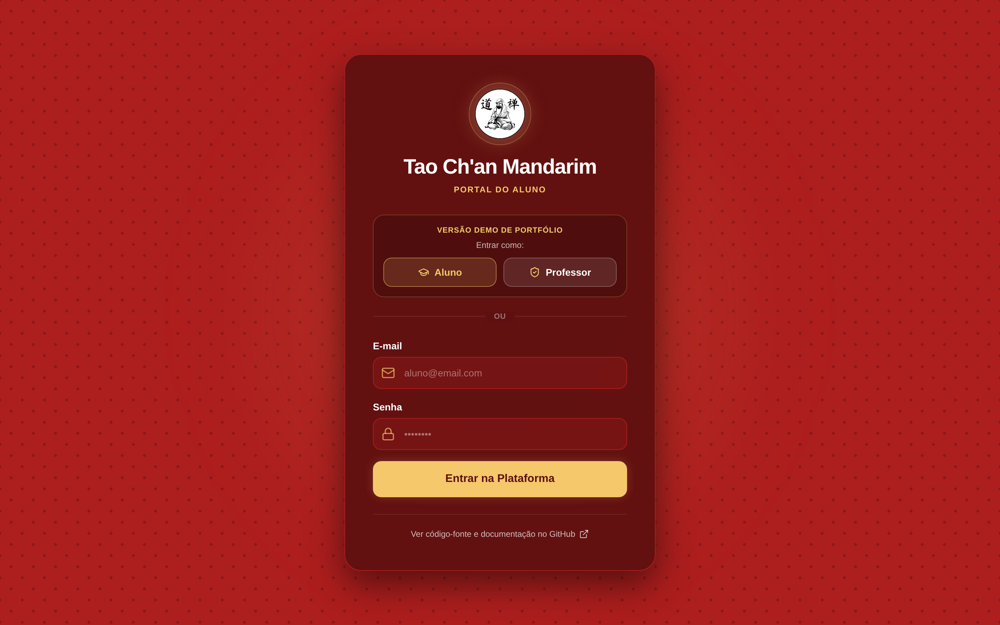
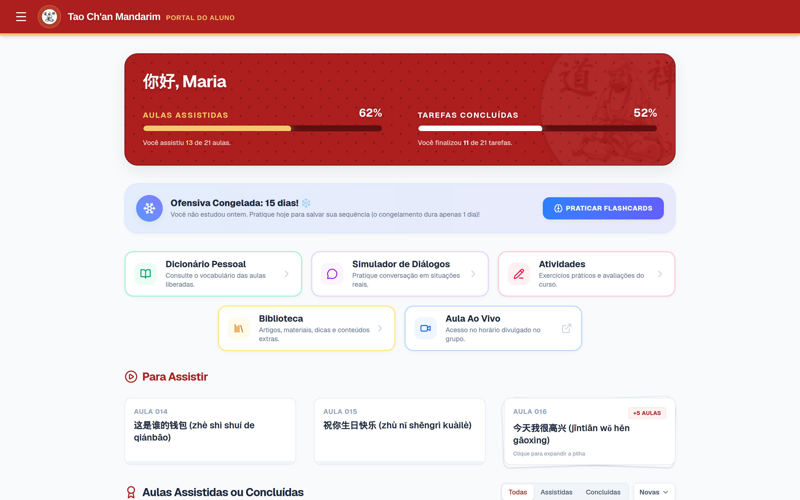
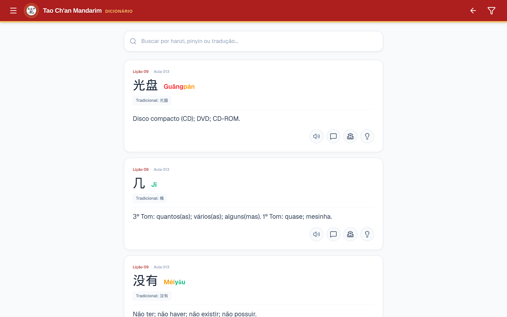
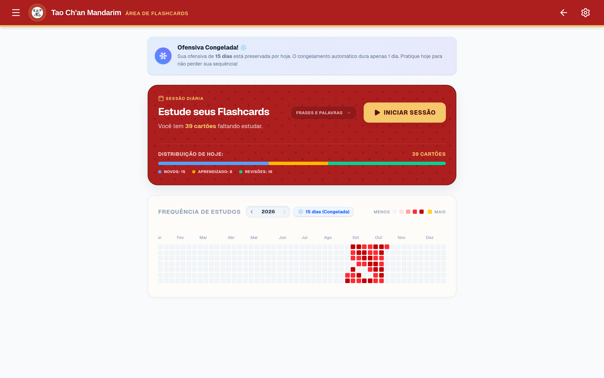
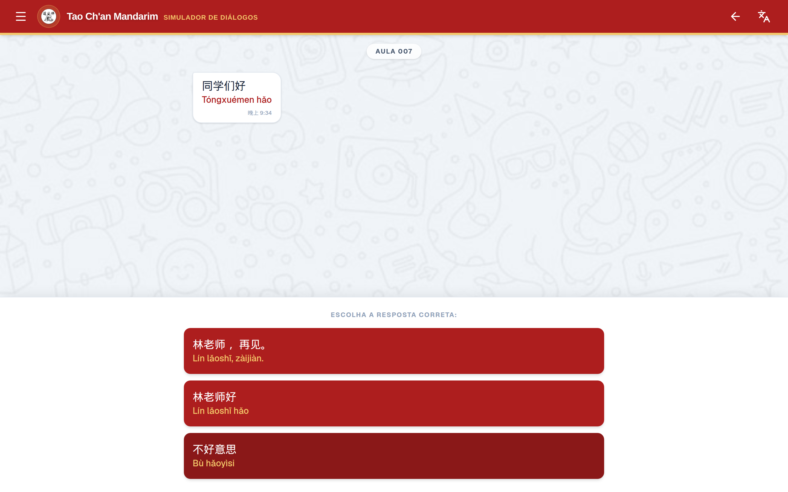
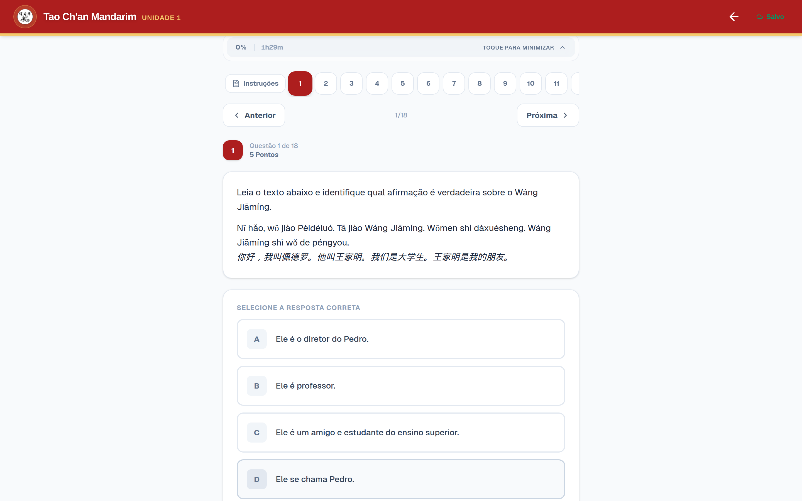
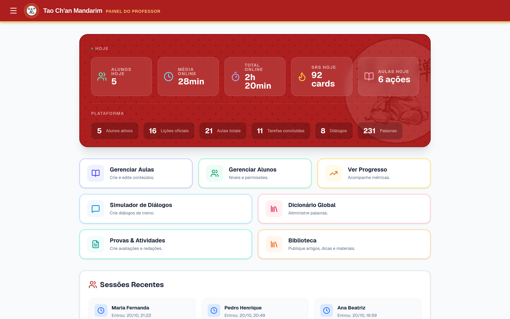
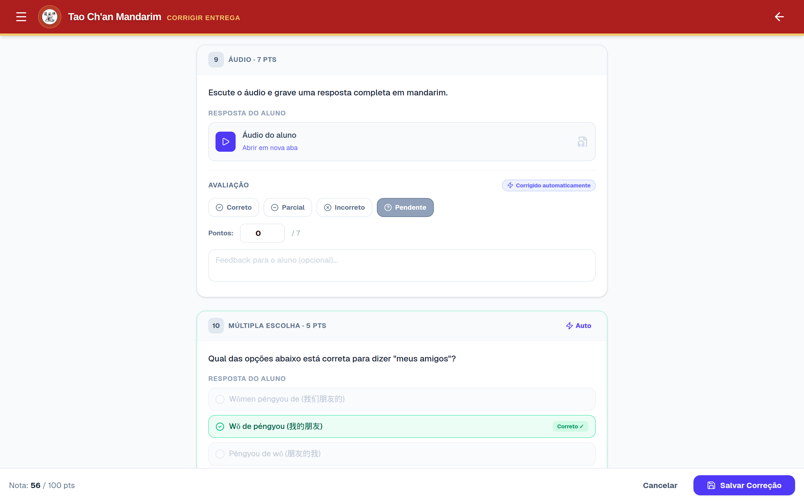

<div align="center">

  🇺🇸 **[English Version](README.md)** · 🇨🇳 **[中文说明](README.zh-CN.md)**
  <br>

  # 🏮 Portal Tao Ch'an Mandarim

  ### **Plataforma educacional interativa criada para estudantes brasileiros de Mandarim, unindo videoaulas, flashcards com repetição espaçada FSRS v4.5, dicionário tonal, simulador de conversação com gravação de voz e provas interativas em múltiplos formatos.**

  [](https://mandarim.lucasresende.com)
  [](#)
  [](#)
  [](#)
  [](#)
  [](#)

  [🔗 **Acesse a Demo (`mandarim.lucasresende.com`)**](https://mandarim.lucasresende.com) · [📖 **Documentação Técnica (15 Capítulos)**](DOCUMENTATION.md) · [🤖 **Arquitetura de Agentes**](AGENTS.md)

</div>

---

## 📌 Visão Geral & A História por Trás do Projeto

Ensinar e aprender Mandarim falando português envolve desafios pedagógicos que plataformas genéricas de cursos raramente resolvem. Atuando como professor voluntário de Mandarim no **Templo Tao Ch'an**, enquanto fazia minha transição da área de **Marketing** e iniciava a graduação em **Análise e Desenvolvimento de Sistemas (Fatec)**, vivi essas dores na prática todas as semanas junto com os alunos:

### ⚠️ Principais Desafios Pedagógicos & Operacionais
* **Jornada de Estudo Fragmentada:** Os alunos precisavam alternar entre links do YouTube para rever aulas, pastas no Google Drive para baixar apostilas em PDF, grupos de WhatsApp para enviar áudios de pronúncia e aplicativos externos de flashcards difíceis de configurar.
* **A Barreira dos Tons e dos Ideogramas (*Hanzi*):** Sem reforço visual para os 4 tons do Mandarim (mais o tom neutro) e sem revisão ativa diária, a curva do esquecimento cobrava seu preço rapidamente (*mā, má, mǎ, mà*).
* **Insegurança para Falar:** Muitos alunos iniciantes sentiam timidez para praticar a fala em voz alta ou não tinham como treinar diálogos estruturados entre uma aula ao vivo e outra.
* **Sobrecarga na Correção de Atividades:** Elaborar avaliações, corrigir exercícios e dar retorno individualizado de pronúncia para dezenas de alunos consumia horas preciosas de trabalho voluntário.

### 💡 A Solução
O **Portal Tao Ch'an Mandarim** nasceu para centralizar toda a experiência de aprendizado em uma única aplicação web *mobile-first*, desenhada especificamente para a pedagogia do ensino de chinês. O aluno assiste às aulas, consulta seu dicionário pessoal desbloqueado progressivamente, revisa cartões com o algoritmo **FSRS v4.5**, treina conversação gravando a própria voz no navegador e realiza avaliações interativas, enquanto o professor gerencia todo o curso, acompanha métricas de engajamento e corrige provas orais e escritas pelo **Painel Laoshi**.

---

## 🖼️ Tour Visual pela Plataforma

### 1. Login Minimalista com Acesso Rápido (Modo Aluno & Modo Professor)
Tela de entrada limpa com identificação clara do ambiente de demonstração (**Versão Demo de Portfólio**), botões de acesso em 1 clique (**Aluno** e **Professor**) e link direto para o código-fonte no GitHub.

<div align="center">
  
</div>

### 2. Painel do Aluno (`/dashboard`)
Exibe o progresso geral no curso, o card de **Ofensiva de Estudos (SRS)**, acesso rápido centralizado aos 5 módulos principais e a pilha inteligente de aulas para assistir e concluídas.

<div align="center">
  
</div>

### 3. Dicionário Pessoal Tonal (`/dashboard/dicionario`)
O vocabulário é liberado automaticamente conforme o aluno avança nas aulas. Cada termo apresenta *Hanzi* simplificado e tradicional, **Pinyin colorido sílaba por sílaba de acordo com o tom**, áudio nativo, frases de exemplo e notas culturais.

<div align="center">
  
</div>

### 4. Flashcards com Repetição Espaçada FSRS v4.5 (`/dashboard/dicionario/srs`)
Motor nativo de repetição espaçada baseado no `ts-fsrs` (Free Spaced Repetition Scheduler v4.5), com barra de distribuição diária (*Novos*, *Aprendizado*, *Revisões*), mapa de calor de frequência anual estilo GitHub e cartões de frente e verso.

<div align="center">
  
</div>

### 5. Simulador de Diálogos em Turnos (`/dashboard/simulador`)
Inspirado em uma interface de mensagens, o simulador apresenta a fala do interlocutor com áudio, desafia o aluno a pensar e gravar sua resposta no microfone (`MediaRecorder` API) e valida a escolha da resposta correta em Mandarim.

<div align="center">
  
</div>

### 6. Motor de Provas e Atividades Interativas (`/dashboard/atividades/[id]`)
Suporta 9 formatos de questões, incluindo múltipla escolha, digitação de Pinyin, ordenação tátil de palavras (`@dnd-kit`), compreensão auditiva, preenchimento de lacunas e **gravação oral de pronúncia**, com salvamento automático na nuvem.

<div align="center">
  
</div>

### 7. Painel do Professor / Laoshi (`/admin`)
Reúne telemetria em tempo real (integração PostHog), indicadores gerais da plataforma, sessões recentes dos alunos, histórico de atividades e um grid simétrico de gerenciamento dos 7 módulos administrativos.

<div align="center">
  
</div>

### 8. Correção Híbrida de Provas (`/admin/atividades/entregas/...`)
Questões objetivas são corrigidas automaticamente no envio, enquanto questões discursivas e gravações de áudio ficam prontas para o professor ouvir, atribuir pontuação total ou parcial e registrar feedback pedagógico por questão.

<div align="center">
  
</div>

---

## 🧠 Engenharia de Software Guiada por Agentes & Metodologia

Faço questão de ser transparente sobre o processo: vindo de uma formação em **Marketing** e estando **no início da graduação em Análise e Desenvolvimento de Sistemas (ADS)**, eu ainda não tinha a bagagem de programação tradicional necessária para escrever do zero, linha por linha, um sistema full-stack de 16 tabelas com React 19, PostgREST e algoritmo FSRS. Ao mesmo tempo, os alunos do Templo Tao Ch'an tinham uma necessidade real e imediata.

Para viabilizar o projeto com qualidade profissional enquanto evoluía nos estudos, atuei como **Product Owner, Analista de Requisitos, Arquiteto de Contexto e QA**, estruturando um fluxo rigoroso de **Engenharia de Software Guiada por Agentes de IA**, com documentação arquitetural viva e scripts determinísticos de validação.

Muito além do chamado *"vibe coding"* (que rapidamente gera código frágil em sistemas maiores), construí uma **Arquitetura de Agentes em 3 Camadas** dentro do próprio repositório:

### 1. Contexto Arquitetural Vivo (`.agents/context/` & `DOCUMENTATION.md`)
Antes de criar ou alterar qualquer funcionalidade, os agentes carregam a fonte única da verdade do projeto ([`AGENTS.md`](AGENTS.md), [`.agents/context/system-map.md`](.agents/context/system-map.md) e os 15 capítulos técnicos em [`.agents/context/documentation/`](.agents/context/documentation/)). Isso garante consistência absoluta no schema PostgreSQL, políticas de Row-Level Security (RLS), camadas de cache do React Query e limpeza de *tracks* de hardware do `MediaRecorder`.

### 2. Skills Especializadas por Domínio (`.agents/skills/`)
Seguindo o padrão de **Progressive Disclosure em 3 Níveis** (`SKILL.md` → `references/` → `scripts/`), estruturei 5 *skills* modulares que fornecem conhecimento especializado sob demanda para a IA:
* **[`mandarin-exam-crafter`](.agents/skills/mandarin-exam-crafter/SKILL.md):** Garante que as provas usem apenas o vocabulário cumulativo que o aluno já aprendeu até aquela unidade, exige distratores fonéticos e tonais plausíveis e valida a soma exata de 100 pontos.
* **[`mandarin-i18n`](.agents/skills/mandarin-i18n/SKILL.md):** Padroniza a normalização Unicode NFC, separação silábica de Pinyin com diacríticos tonais e estruturas bilíngues PT-BR/Mandarim.
* **[`portal-frontend`](.agents/skills/portal-frontend/SKILL.md):** Governa fronteiras Server/Client do Next.js 16 App Router, tokens do Tailwind CSS v4, liberação de microfone e acessibilidade WCAG AA.
* **[`portal-backend`](.agents/skills/portal-backend/SKILL.md):** Padroniza migrações Supabase PostgreSQL, políticas RLS (`is_admin()`), Server Actions e sanitização determinística de arquivos no Storage.
* **[`portal-refactor-guard`](.agents/skills/portal-refactor-guard/SKILL.md):** Orquestra refatorações em todas as 7 camadas da aplicação (Banco, Actions, Tipos, Componentes, Rotas, Estilos e Documentação).

### 3. Portões de Qualidade Determinísticos em Python (`scripts/`)
Como modelos de linguagem são probabilísticos, **a validação precisa ser determinística**. Cada *skill* conta com scripts CLI em Python que auditam o código antes de finalizar qualquer entrega:
* `validate_exam.py`: Valida JSONs de provas (soma de 100 pontos, schemas das 9 tipologias de questão e *whitelist* de caracteres *Hanzi*).
* `pinyin_auditor.py`: Inspeciona código e dados em busca de sílabas Pinyin com tons inválidos ou Unicode desnormalizado.
* `schema_validator.py`: Audita migrações SQL verificando chaves estrangeiras sem índice, tabelas sem RLS ativo e caminhos de storage inseguros.
* `blast_radius_scanner.py`: Mapeia o raio de impacto nas 7 camadas do sistema antes de renomear entidades.
* `checklist.py`: Suite mestre de verificação executada antes de cada commit.

---

## 🧪 Sandbox Zero-Backend para Portfólio

Para preservar 100% da privacidade dos alunos reais e, ao mesmo tempo, permitir que qualquer pessoa teste todas as funcionalidades (incluindo gravação de áudio, revisão de flashcards FSRS, envio de provas e correção pelo professor) **sem depender de um banco externo e sem consumir limites gratuitos de nuvem**, esta edição de portfólio conta com um **Emulador Supabase/PostgREST in-browser** ([`lib/demo/supabaseSandbox.ts`](lib/demo/supabaseSandbox.ts)):

* **Interceptação Transparente de `fetch`:** Intercepta chamadas para `*.supabase.co` (`/auth/v1`, `/rest/v1` e `/storage/v1`) tanto no servidor (Next.js Server Components) quanto no navegador.
* **Motor PostgREST em TypeScript:** Suporta filtros complexos (`eq`, `neq`, `in`, `not`, `or`, `ilike`), *joins* relacionais (`select=*,aulas(titulo)`), cabeçalhos `Prefer: count=exact` (`Content-Range`), *upserts* (`on_conflict`) e chamadas RPC (`rpc/is_admin`).
* **Persistência em `localStorage` e Troca Instantânea de Papel:** Inicializa dados fictícios realistas a partir de [`lib/demo/seedData.json`](lib/demo/seedData.json) e oferece uma barra flutuante (**ModoPortfólio**) no canto inferior direito para alternar entre **Modo Aluno (Maria Fernanda)** e **Modo Professor (Prof. Lucas)** ou restaurar os dados originais a qualquer momento.

---

## 🛠️ Tecnologias Utilizadas

| Camada | Tecnologias & Bibliotecas |
| :--- | :--- |
| **Framework & UI** | [Next.js 16.2 (App Router)](https://nextjs.org/), [React 19.2](https://react.dev/), [TypeScript 5](https://www.typescriptlang.org/), [Tailwind CSS v4](https://tailwindcss.com/) |
| **Estado & Cache** | [TanStack React Query v5](https://tanstack.com/query/latest) (Atualizações otimistas e cache estratificado por `staleTime`) |
| **Backend & Auth** | [Supabase](https://supabase.com/) (PostgreSQL, Row-Level Security, Auth Helpers, Storage) + Sandbox Local Zero-Backend |
| **Repetição Espaçada & Drag-and-Drop** | [`ts-fsrs` v5 (FSRS v4.5)](https://github.com/open-spaced-repetition/ts-fsrs), [`@dnd-kit`](https://dndkit.com/) (Ordenação tátil acessível) |
| **Editor Rico & Mídia** | [Tiptap Editor](https://tiptap.dev/), Web `MediaRecorder` / `MediaStream` API, [Framer Motion v12](https://motion.dev/) |
| **Observabilidade & Qualidade** | [PostHog](https://posthog.com/) (Product Analytics), Scripts Determinísticos de QA em Python 3.12 |

---

## 📂 Estrutura do Projeto

```text
.
├── .agents/
│   ├── context/               # Mapa do sistema, glossário de Mandarim e 15 capítulos técnicos
│   ├── rules/                 # Diretrizes arquiteturais sempre ativas (GEMINI.md)
│   ├── scripts/               # Suite mestre de validação (checklist.py)
│   └── skills/                # 5 Agent Skills modulares + validadores determinísticos em Python
├── app/
│   ├── admin/                 # Painel do Professor (Laoshi): aulas, alunos, provas, entregas e blog
│   ├── api/                   # Route handlers (proxy de métricas PostHog e endpoints de apoio)
│   ├── components/            # Componentes globais, Navbar, Sidebar e PortfolioDemoBar
│   ├── dashboard/             # Portal do Aluno: aulas, dicionário, flashcards FSRS, simulador e provas
│   ├── demo/                  # Visualizador simulado de apostilas e materiais para o modo portfólio
│   └── login/                 # Autenticação híbrida (Supabase Auth + Acesso Rápido Demo em 1 clique)
├── lib/
│   ├── demo/                  # Emulador Supabase/PostgREST zero-backend e seedData.json anonimizado
│   ├── supabase/              # Clientes Supabase tipados (Client, Server Components e Service Role)
│   ├── pinyinUtils.ts         # Parser de Pinyin tonal, separador silábico e mapeamento de cores
│   └── storageUtils.ts        # Sanitização determinística de chaves de arquivos no Storage
├── public/
│   ├── demo-storage/          # Áudios e imagens estáticas para funcionamento 100% autônomo da demo
│   └── docs/screenshots/      # Capturas de tela em alta definição da plataforma
├── supabase/
│   └── migrations/            # Schema PostgreSQL completo, triggers e políticas RLS
├── types/                     # Interfaces TypeScript estritas para tabelas, provas e FSRS
├── AGENTS.md                  # Roteador de contexto e instruções para agentes de IA
├── DOCUMENTATION.md           # Documentação técnica consolidada em 15 capítulos
├── README.md                  # Documentação principal em inglês
└── README.pt-BR.md            # Documentação em português
```

---

## 🚀 Como Executar o Projeto Localmente

Graças ao **Sandbox Zero-Backend**, você pode clonar e rodar o sistema completo imediatamente, **sem precisar criar conta no Supabase ou configurar chaves de API**:

1. **Clone o repositório e instale as dependências:**
   ```bash
   git clone https://github.com/lucasresendev/portal-tao-chan-mandarim.git
   cd portal-tao-chan-mandarim
   npm install
   ```

2. **Inicie o servidor de desenvolvimento (o Modo Demo já vem ativo por padrão no `.env.example`):**
   ```bash
   cp .env.example .env.local
   npm run dev
   ```

3. **Acesse `http://localhost:3000` no navegador:**
   * Clique em **Aluno** para testar aulas, flashcards FSRS, simulador de diálogos e provas como *Maria Fernanda*.
   * Clique em **Professor** (ou use o botão flutuante **ModoPortfólio** no canto inferior direito) para explorar o painel administrativo, progresso da turma e correção de provas como *Prof. Lucas*.

4. **(Opcional) Execute a suite de verificação de qualidade dos agentes:**
   ```bash
   python3 .agents/scripts/checklist.py .
   ```

---

## 📄 Licença & Atribuição

Este projeto é distribuído sob os termos da **[PolyForm Noncommercial License 1.0.0](LICENSE)**.

* **Usos Permitidos:** Estudos pessoais, pesquisas acadêmicas, fins educacionais sem fins lucrativos e avaliação de portfólio.
* **Restrições Comerciais:** É estritamente vedada qualquer utilização comercial, revenda ou exploração monetizada sem autorização prévia por escrito.
* **Autor & Arquiteto:** [Lucas Resende](https://github.com/lucasresendev)
* **Diretrizes de Atribuição:** Veja o arquivo [ATTRIBUTION.md](ATTRIBUTION.md) para orientações sobre créditos e referências.

---

## 👤 Autor

<div align="center">

  ### **Lucas Resende** (`@lucasresendev`)
  *Desenvolvedor de Software & Estudante de Análise e Desenvolvimento de Sistemas (Fatec Taubaté)*

  [](https://linkedin.com/in/lucasresendev)
  [](https://lucasresende.com)
  [](https://github.com/lucasresendev)

</div>
